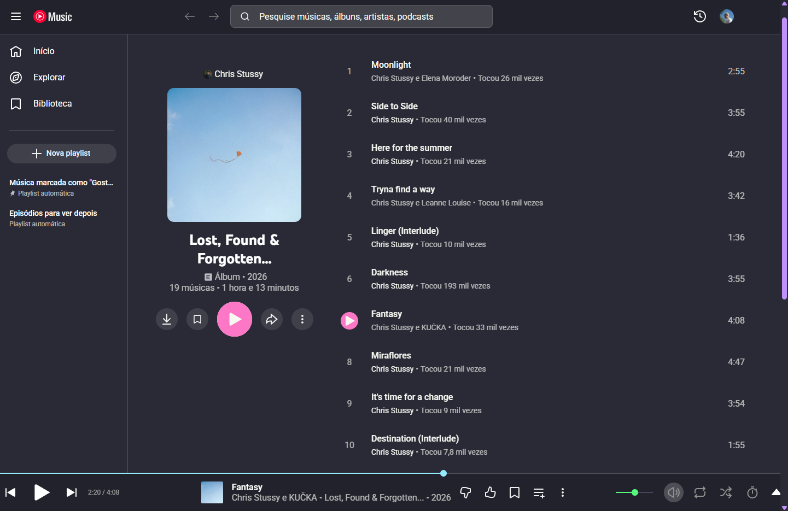

# Dracula for [YouTube Music Desktop](https://ytmdesktop.app/)

> A dark theme for [YouTube Music Desktop](https://ytmdesktop.app/).

Theme originally based on the css files from [OceanicSquirrel](https://github.com/OceanicSquirrel/themes-for-ytmdesktop-player), with a refactored build using semantic CSS variables, smooth transitions, keyboard focus styles, and deduplicated rules.

## Install

All instructions can be found at [draculatheme.com/youtube-music-desktop](https://draculatheme.com/youtube-music-desktop).

## Team

This theme is maintained by the following person(s) and a bunch of [awesome contributors](https://github.com/dracula/youtube-music-desktop/graphs/contributors).

|  |
| ------------------------------------------------------------------------------------------ |
| [MayhemBill](https://github.com/MayhemBill)                                                |

## Community

- [Twitter](https://twitter.com/draculatheme) - Best for getting updates about themes and new stuff.
- [GitHub](https://github.com/dracula/dracula-theme/discussions) - Best for asking questions and discussing issues.
- [Discord](https://draculatheme.com/discord-invite) - Best for hanging out with the community.

## License

[MIT License](./LICENSE)